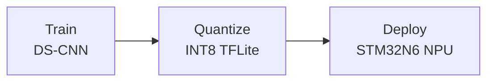

# BirdNET-STM32

Bird sound classification for edge deployment on the
[STM32N6570-DK](https://www.st.com/en/evaluation-tools/stm32n6570-dk.html)
development board with neural processing unit (NPU).

## Overview

BirdNET-STM32 trains a compact depthwise-separable CNN (DS-CNN) on raw
waveforms or spectral features, quantizes it to INT8 via post-training
quantization, and deploys the resulting TFLite model to the STM32N6570-DK
using ST Edge AI Core.



The current release, **2.1 Raw**, classifies 1,007 bird species from 2.5
seconds of 24 kHz audio in **32 ms of NPU time** (92 ms per file on the board
including the SD-card read), about 78x faster than real time. Raw models run
entirely on the NPU; the hybrid model (2.0 Hybrid) computes its STFT on the
Cortex-M55 first. See [Pre-trained Models](pretrained-models.md) for every
release's accuracy and on-board figures.

## Quick start

```bash
# Clone and install
git clone https://github.com/birdnet-team/birdnet-stm32.git
cd birdnet-stm32
python3.12 -m venv .venv && source .venv/bin/activate
pip install -e ".[dev]"

# Train (the defaults are the release recipe: raw frontend, 2.5 s at 24 kHz)
python -m birdnet_stm32 train --data_path_train data/train

# Convert to quantized TFLite
python -m birdnet_stm32 convert \
  --checkpoint_path checkpoints/best_model.keras \
  --model_config checkpoints/best_model_model_config.json \
  --data_path_train data/train

# Evaluate
python -m birdnet_stm32 evaluate \
  --model_path checkpoints/best_model_quantized.tflite \
  --model_config checkpoints/best_model_model_config.json \
  --data_path_test data/test
```

See the [Getting Started](getting-started.md) guide for full setup instructions
and the [Deployment](deployment.md) guide for flashing the STM32N6570-DK.

You do not have to train your own model. Trained and converted models are
published as release assets — see [Pre-trained Models](pretrained-models.md) for
what a bundle contains and how to run one on the board.

## Key features

- **Three audio frontends**: `librosa` (precomputed mel), `hybrid` (linear STFT
  + learned mel mixer), and `raw` (waveform → learned filterbank) — all
  quantization-friendly and all supported by the firmware.
- **N6-B0 backbone**: EfficientNet-B0 with ReLU6, no squeeze-and-excite and a
  bounded residual stream, built for INT8 on the N6. The default from 2.3
  widens it where 2.2 used its width (`efficientnet_b0_n6w`); 2.2's N6-B0
  (`--backbone efficientnet_b0_n6`) and the DS-CNN of the releases up to 2.1
  (`--backbone dscnn`, with its width, per-stage width and depth knobs) stay
  available.
- **Head fine-tuning** (`finetune-head`): after training, refits the classifier
  on the frozen backbone over every training file, optionally weighing negatives
  by geographic co-occurrence; +4% WABAD AUPRC on 2.1 Raw. See
  [Training](training.md#head-fine-tuning).
- **Post-training quantization**: float32 I/O with INT8 internals, targeting
  >0.95 cosine similarity vs. the float model. Activation ranges at the
  99.999th percentile of the calibration data; per-channel (default) or
  per-tensor.
- **Quantization-aware training (QAT)**, not in the 2.x recipe: per-channel kernel and per-tensor
  activation INT8 simulation via `--qat`, aligned to final conversion's exact
  calibration manifest. Frozen-teacher KL plus mean and worst-sample cosine
  consistency protect mean and tail parity. The saved deployment checkpoint
  has no FakeQuant ops and remains N6 compatible.
- **Device-facing operational report**: `measure-operational` scores the
  converted INT8 model on its own at a real operating threshold, reporting the
  detections and false alarms a device would see (a release gate in 1.x,
  reported from 2.0).
- **Comprehensive evaluation**: ROC-AUC, cmAP, F1, species-level AP with
  bootstrap CI, DET curves, latency measurement, benchmark mode, and HTML
  reports.
- **End-to-end deployment**: `stedgeai generate` → serial flash → on-device
  validation, all from the CLI.

## Project layout

```
birdnet_stm32/      # Python package (models, audio, data, deploy, ...)
  cli/              # CLI subcommands (train, convert, evaluate, measure-operational, deploy, board-test)
  models/           # DS-CNN, frontend, magnitude scaling, profiler
  audio/            # Audio I/O, spectrogram, augmentation
  training/         # Trainer, QAT, distillation losses, linear probing
  conversion/       # PTQ, validation, ONNX export
  evaluation/       # Metrics, pooling, reporting
  deploy/           # stedgeai wrappers, N6 loader
firmware/           # Standalone C firmware for STM32N6570-DK
docs/               # This documentation
```

All commands use the unified CLI entry point:

```bash
python -m birdnet_stm32 {train,convert,evaluate,measure-operational,deploy,board-test}
```
